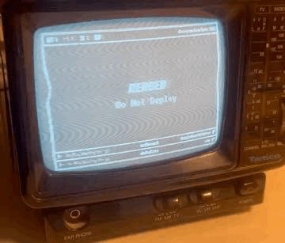

# `crtboard`

> [!CAUTION]
>
> This is a wholly vibecoded project, although the system
> design, (including docs/System.md, besides a few small lines
> dumb Claude added), the actual UI/UX design was done completely by
> me, *do not* use this project for anything that is remotely important
> this is largely a shitpost, but an elaborate one.



CRT + Dashboard, Turn your old PAL TV to a dashboard showing your:

* Asana tasks
* Open GitHub PRs
* Approaching events

## Installation

* You will need `gh`, `git` and `python` on your computer,
  you will also need a Chromium based browser
* Install `crtboard` Python package on the releases
* Add its configuration to `~/.crtboard.yaml` (see below)
* Run a public server using `crtboardctl`
* Deploy the scripts under `gateway` to your Raspberry Pi 4B
* Connect your Raspberry Pi 4B to your local computer
* Go to `crtboard.amberti.de` and press broadcast, select your
  Raspberry Pi 4B
* Configure which one of the git repos and which asana board you
  want to track, alternatively input some repeated events using
  cron.
* Enjoy.

<details>

<summary>Configuration</summary>

```yaml
git-repositories:
  - /Users/elsa/Projects/crtboard
  - /Users/elsa/Projects/beemu
  - /Users/elsa/Projects/datalite
  - /Users/elsa/Projects/metronode
githubUsernames: [ambertide]
port: 7777
```

Also expose your Asana Personal Access Token as
`ASANA_API_KEY` environment variable
</details>

## Technical Details

> [!TIP]
>
> Refer to 99% human written [System.md](docs/System.md) file
> for more

* `crtboardctl` runs a background server called `crtboardd` which
  gathers your available git repos and asana boards from your provided
  config
* `crtboard.amberti.de` connects to `crtboardd` and then allows you to
  choose which one of these repos you want to see on your dashboard
  as well as which board and columns
* `crtboard.amberti.de` then uses canvas api to draw frames and
  send them one by one, 25 times per second, to the Raspberry Pi,
  using WebSerial
* `crt-display` on raspberry pi then displays them to the framebuffer
  which gets outputted as a PAL signal
* For my setup: A TV Tuner was necessary to then convert this
  composite video signal to a TV broadcast signal, and an adapter
  to get it into the TV, now, my TV's Channel 4 is my dashboard. 
