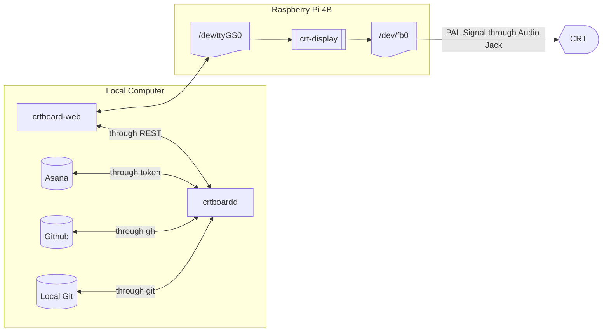

# System Design Document for CRTBOARD

CRTBOARD is a single user dashboard which allows you to harvest data
from your local computer and view it as a monochrome dashboard
in an old CRT monitor supporting the European PAL format.

* CRTBOARD is a system of three distinct software parts:
  * `crtboardd`: Used to get data from your local computer and serve
    it over the web using `python` so that the rest of the system can reach it.
  * `crtboard-web`: The web ui you can use to edit the look and
    feel of your crt-dashboard
  * `crt-display`: a go script deployed to a Raspberry Pi
    4B running Rasbian so that the Raspberry Pi may act as a gateway
    between your local computer and your CRT Television (or any other
    device that accepts composite video output)
* Provided these three services are up, and running, CRTBOARD will
  display a dashboard of your chosen configuration on a device that
  accepts a PAL video signal.



## `crtboardd`

`crtboardd`, short for `crtboard` daemon, is a daemon process
that runs the HTTP REST based webserver to communicate with the
CRTBOARD's web ui.

`crtboardd` is configured with a `.crtboard.yaml` file, by default
residing at your home directory, `crtboardd` can be started or
stopped with the `crtboardctl` command, during its startup, another
`.crtboard.yaml` file may be provided.

`.crtboard.yaml` file contains the following information:

* `git-repositories`, an array of absolute paths to repositories
  you wish to track on `crtboard`
* `asana-api-key` your api key to asana so that `crtboard` can
  query your boards, and tasks.
* `githubUsernames` for whose PRs to track
* `port` the port by which the `crtboardd` is served, `7777` by default.
`crtboardd` requires `go` and `gh` to exist in your system, and your
`gh` executable to be logged in, in addition `git` is required so
that `crtboardd` can listen to your repositories.

`crtboardd` uses:

* `asana`'s events interface so it can safely, and without the need
  of an internet accesible server, periodically scan for new asana
  events on your boards.
* `gh` to scan for new pull requests and review requests
* `git` to periodically check which branch you are at your tracked
  PRs.

For these reasons connected server can use the Rest API thus:

* When the WebUI first connects, it `GET`s for `/resources/available`,
  to this `crtboardd` responds with available `asanaBoards` and
  `gitRepos`
  * `asanaBoards` payloads also include `availableColumns`
* According to user choices, the webUI may then `POST`
  `/resources/git/tracked` or `/resources/asana/tracked` resources to
  mark particular boards and git repositories to be tracked, these
  are stored by `crtboardd` in an `sqlite` database, since this is
  a single user system.
  * User is also expected to match columns shown in the UI with
      actual columns in the board, there are four columns which
      are shown in the ui, with following enums: `"BLOCKED"`, `"DONE"`,
      `"IN_PROGRESS"` and `"TO_DO"`
* These resources are given IDs so the client may `PUT`
  `resources/#resource/tracked/#id` to update them, or `DELETE` it to
  stop tracking them. An unknown id is answered with `404`, after which
  the client tracks the resource anew. Only one board is tracked at a
  time, so tracking a board replaces the previous one.
* Once these connections are established, the server will start
  sending Server Sent Events from `/events`.
* Periodically, the daemon will send, `CRTBOARD_EVENT_SUM` events, 
  even if the payload does not change, which have the following JSON 
  shape:

```json
{
    "gitRepos": {
        "repoName": {
            "PRs": 34,
            "todaysMergedPRs": 0,
            "branch": "feat/tokenizer/add-ld",
            "reviewRequested": 5
        }
        ...
    },
    "asanaBoards": {
        "todo": {
            "matchedColumnName": "Will Do",
            "tasks": 25
        }
        ...
    }
}
```

`asanaBoards` is keyed `todo`, `blocked`, `inProgress` and `done`, for
the `TO_DO`, `BLOCKED`, `IN_PROGRESS` and `DONE` columns that are matched.

These are calculated by:

* For `asanaBoards`
  * Number of total tasks in the selected columns for each column
  * Except for `DONE` column, since this column will always grow,
    we only store the tasks that were done in this day.
* For `gitRepos`
  * Current active branch of the repository for each repository.
  * Current PRs, number of PRs either opened by or whose review was
    requested for in the list of `githubUsernames`, these can be
    open, merged or draft. If a PR is both opened by a member of this
    array and review is requested to one of them, it is deduplicated,
    so it is counted only once.
  * `reviewRequested` which tracks the number of open, draft or merged
    PRs which have a review request to one or more `githubUsernames`
    members, these are counted even if they were counted in the above
    number.
  * `todaysMergedPRs` track the number of merged PRs today

## `crtboard-web`

`crtboard-web` is the static frontend of this project, written in
Svelte and compiled to a static bundle to be able to be served on
a CDN or GitHub Pages

* `crtboard-web` has two essential parts:
  * a control settings pane below
    * This panel initially waits for user to enter the port and connect
    * It reverts to this state if `CRTBOARD_EVENT_SUM` are missed, this
      way they act as a heartbeat check also
    * Your changes are immeditely saved and sent to the `crtboardd`
  * the WYSIWYG preview of the dashboard on the top,
    * this WYSIWYG preview is also wrapped in a [WebGL Shader](https://github.com/gingerbeardman/webgl-crt-shader)
    * If the connection is distrupted, or before it is established
      the WYSIWYG preview displays a Phillps PM5540 Test Card
* Once the user enters the webpage, control panel connects to
`crtboardd`, meanwhile, the WYSIWYG panel includes a button which
when pressed prompts the `WebSerial` serial source picker so that
the user can choose the previously connected Raspberry Pi 4B device.
* `crtboard-web` updates this WYSIWYG image and then takes the
screenshot of that image 25 times per second, to match the frequency
of the European PAL TV Signal, this screenshot is taken through
`canvas.toBlob` API function, this image is then transmitted through
`WebSerial` into the Raspberry Pi

> [!CAUTION]
>
> The reason we depend on `crtboard-web` when we could have just
> as easily transmit this data through `crtboardd` is to rely on
> the safety procedures already built into `WebSerial`

For state management purposes, `crtboard-web` stores your tracked
asana board and your tracked git repos, which can only be two, in
the localstorage, during initial connection it tries to find them in
the `available*` resource blocks.

In addition, `crtboard-web` also owns and manages repeating events,
which are events with names such as Daily Meeting and a cron
expression, for instance `30 10 * * *`, `crtboard-web` tracks if the
current time is ~10m away from this event and then shows a tracker
in the dashboard with the event name in all caps

## `crt-display`

The gateway go service is a `systemd` service which allows for the
Raspberry Pi to read incoming screenshots from `/dev/ttyGS0`,
the serial port file, and write to `/dev/fb0` which is the visual
frame buffer.

Your raspberry pi must also be deployed with deployment scripts in
`gateway` folder, if it is done so, it will emit any frames written
to `/dev/fb0` as composite video output encoded in the European
Phase Alternating Line, or PAL, format.

`crt-display` takes the frames written to `/dev/ttyGS0` by the
`crtboard-web` and simply displays them, allowing your computer
to act as the single source of truth.

> [!TIP]
>
> Note that composite here refers to the three cabled, Yellow, White
> and Red, old video format and not the newer S-Video format, which
> the Raspberry Pi lacks the power to prouce.

You can plug this composite video feed to a CRT Monitor which
understands a composite video signal, or a TV Tuner which will then
convert it into a TV Signal instead, which you can connect to a really
old computer.

Gateway scripts will also modify your raspberry pi to act as a
OTG Device so that it can connect to webserial to start with.